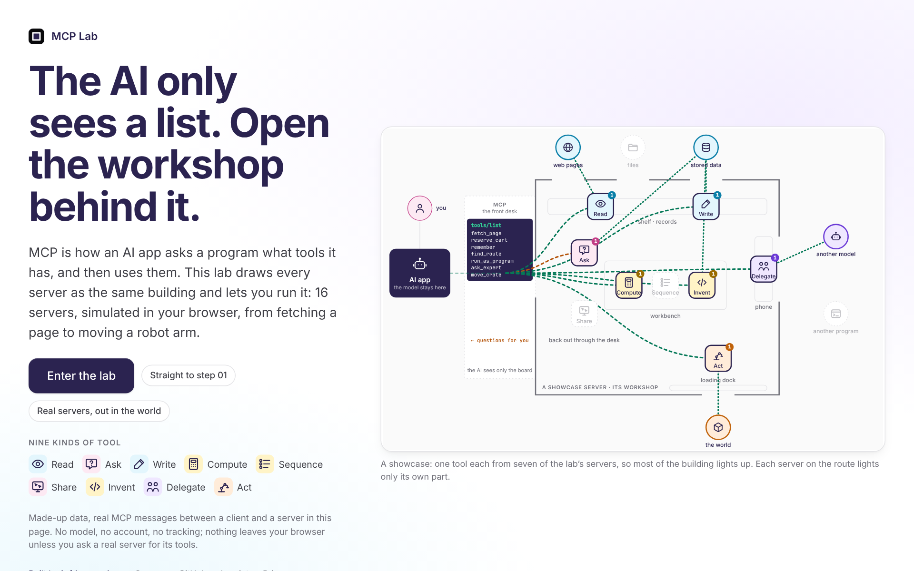
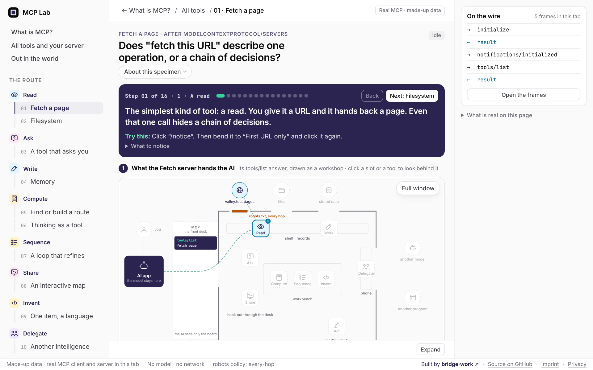

#  MCP Lab

**The AI only sees a list of tools. Open the workshop behind it.**

An interactive lab for the [Model Context Protocol](https://modelcontextprotocol.io): what an AI app is actually handed when it connects to an MCP server, and what each tool on that list really reaches. Runs entirely in your browser.

**[Open the lab → mcp-lab.bridge-work.ai](https://mcp-lab.bridge-work.ai/)** · [In the bridge·work Lab](https://bridge-work.ai/lab/tool/mcp-lab/) · MIT licensed



## What it is

When an AI app connects to an MCP server, the first thing it receives is a list: tool names, descriptions, input schemas. That list is all the model ever sees. MCP Lab draws what is behind it.

- **What is MCP?, in five scenes.** For someone who has never heard of it: you scroll the story, and the drawing beside it changes with each scene — the AI app alone, the list at the front desk, the workshop behind it, one call, and why the list is not enough.
- **The workshop.** Every server is drawn as the same building. You and the AI app stand outside; MCP is the front desk where the `tools/list` board hangs. Behind it are nine places a tool can sit — Read, Ask, Write, Compute, Sequence, Share, Invent, Delegate, Act — and outside the walls, what the tools reach: web pages, files, stored data, other programs, another model, the physical world. Rules sit in the wall openings. Where the picture simplifies, the lab says so.
- **The route.** 16 simulated servers climbing that ladder, from fetching a page to a server that asks you a question mid-call (`elicitation/create`) to a simulated robot arm. Each step has one idea, one thing to try and one thing to notice, and lets you bend the server and watch what changes.
- **Out in the world.** A library of 64 real MCP servers, four per step: the most used, the first, a weird one, and one that almost breaks the idea. Each card says how its evidence was obtained.
- **Your server.** Paste a tool list, or point the lab at an MCP endpoint, and see it drawn as a workshop.



### What is real

- A real MCP client and a real MCP server, built on the official TypeScript SDK, run inside the tab and talk over its in-memory transport. Every run is an actual `tools/call`; you can open the frames.
- The data is made up. No model runs, there is no account and no tracking, and nothing leaves your browser — except when you ask a real server for its tool list under "Your server".
- Python in step 09 runs for real in the tab (Pyodide).

## Run it locally

Requires Node 22.18 or newer. No cloud account, API key or model is needed.

```bash
npm install
npm run dev          # the lab at http://localhost:5173
npm test             # domain, state, UI, CLI and MCP integration tests
npm run typecheck && npm run lint && npm run build
```

The same engine has two more entrances, a CLI and an MCP stdio server you can connect any MCP client to:

```bash
npm run lab -- list
npm run lab -- connect_places --from forge --to dock            # succeeds
npm run lab -- connect_places --from forge --to dock --storm    # controlled failure, exit 1
npm run lab -- fetch_page --url https://valley.test/notice --policy first-hop
npm run mcp:server   # MCP server over stdio
npm run record       # rerun the CLI and MCP exchange shown in the lab
```

Built with [Effect](https://effect.website) and [Foldkit](https://github.com/foldkit/foldkit) (an Elm-style architecture) and Vite.

- `src/domain` — the engine: servers, tools, the world they change. No DOM, no transport.
- `src/adapters` — in-process, CLI, MCP stdio and remote-listing entrances.
- `src/lab` — the Foldkit app: model, update, views, the workshop drawing.
- `specimens/` — the route's research notes and the library data.

### Deploy

The site is static. `npm run build` writes `dist/`; [`wrangler.jsonc`](wrangler.jsonc) serves it as Cloudflare Workers static assets on `mcp-lab.bridge-work.ai`. Deploys run on Cloudflare; see [docs/HANDOFF.md](docs/HANDOFF.md) for the current setup.

## Contributing

Issues and pull requests are welcome. Run `npm run typecheck && npm run lint && npm test && npm run build` before opening one. [AGENTS.md](AGENTS.md) holds the working rules, [CONCEPT.md](CONCEPT.md) the direction, and [docs/DECISIONS.md](docs/DECISIONS.md) why things are the way they are. Report security issues as described in [SECURITY.md](SECURITY.md).

## Privacy

MCP Lab runs entirely in the browser. What you do in the lab stays on your device and is not uploaded. There are no accounts, no analytics and no tracking, and the fonts are served with the site (no font host). One exception the visitor starts: under "Your server", "Ask for its tools" sends initialize and tools/list from the browser to the address they type. The hosting provider may process technical connection data to deliver and secure the site. Operator and full notice: [bridge-work.ai privacy](https://bridge-work.ai/en/privacy/) · [imprint](https://bridge-work.ai/en/imprint/).

## Also in this repository

- **The earlier workbench** (`lab/`, the 18 November prototype): an IDE-style workbench for newcomers with one playable notes model and seven source-backed previews. Kept as reference; see [lab/README.md](lab/README.md). The Foldkit lab above (`src/`) is the current app, and `npm run build` builds only that.
- **Lab Factory** ([tooling/](tooling/README.md)): bounded native workers, source evidence, artifact revisions, deterministic checks, advisory review and learning feedback. Runtime history stays in ignored `.lab/`.
- Direction: [CONCEPT.md](CONCEPT.md). Current evidence and next work: [docs/HANDOFF.md](docs/HANDOFF.md). Historical experiments: `tooling/docs/experiments/`.

## Licence

[MIT](LICENSE) © 2026 blackmath88. Built by [bridge·work](https://bridge-work.ai/lab/) · [Imprint](https://bridge-work.ai/en/imprint/) · [Privacy](https://bridge-work.ai/en/privacy/)
