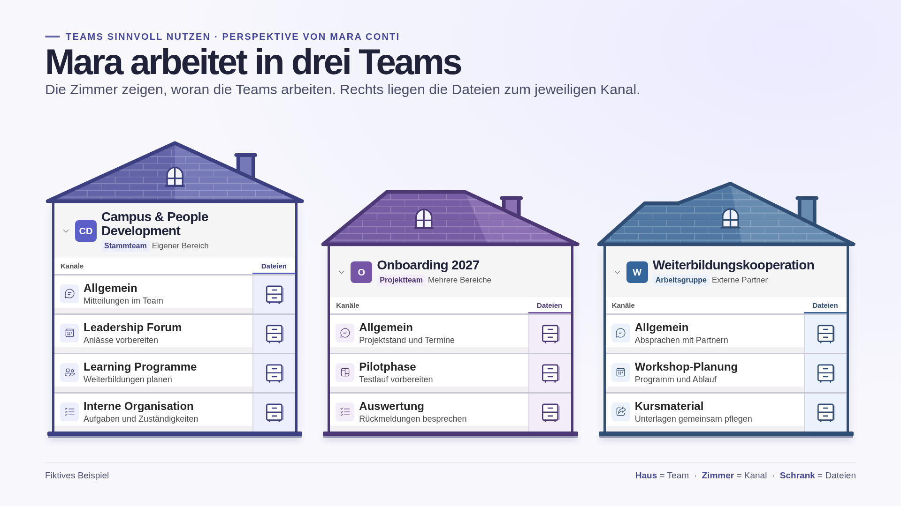
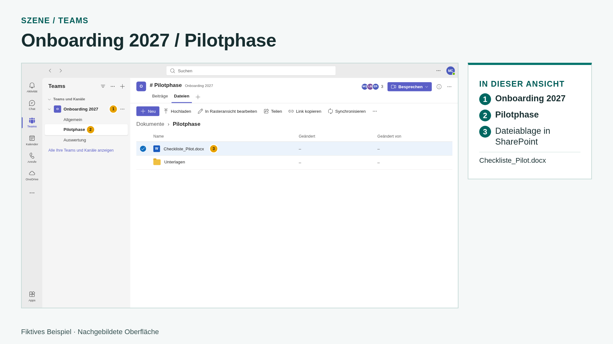
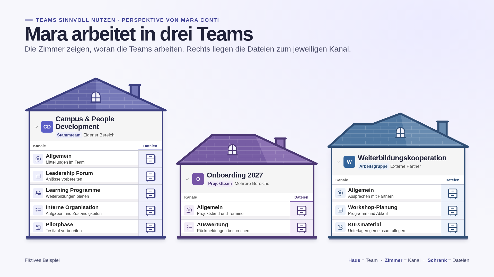
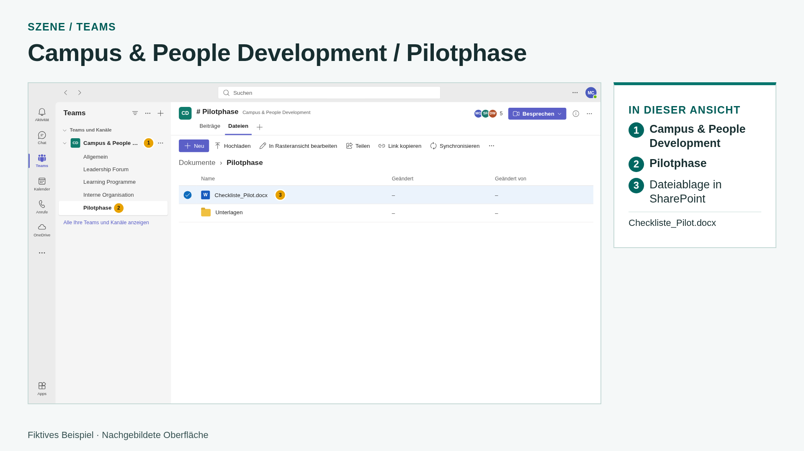

# Experiment 01: move one room

**Question:** what becomes checkable when an assistant can change an editable project through MCP?

This is fictional training data. Houses stand for Teams, rooms stand for channels, and cabinets stand for files. Nothing here moves a real Microsoft Teams channel.

## 1. Find Pilotphase

In the starting image, the middle house is **Onboarding 2027**. It contains the room **Pilotphase**. The room has a checklist and supporting folders.

Look at the Teams view of the same room. The selected file is **Checkliste_Pilot.docx**.

## 2. Move it to the left-hand house

The experiment changes the room's parent from `onboarding` to `campus`. It keeps the room's ID, `pilot`, and the IDs and parent links of its files and folders. It also changes the detail scene's focus and the presenter note to follow the new location.

Now the room appears inside **Campus & People Development**. Onboarding has one fewer room; Campus has one more.

The checklist is still selected. Its filename and logical ID have survived. We did not rebuild a lookalike room and delete the old one.

## 3. See what proves that

| Evidence | What it establishes |
| --- | --- |
| Images above | A visible change of location |
| [Before JSON](before.json) and [after JSON](after.json) | Stable IDs and descendant links; changed parent, scene root and note |
| [Move recipe](recipe.json) | The explicitly requested transformation |
| [Evidence index](evidence.json) | Artifact IDs, hashes, source revision and recorded criterion status |

A picture alone cannot tell whether an object was moved or replaced by an identical-looking one. Here the structured project and independent diff check establish logical identity. Image hashes establish identical bytes, which is a different property.

## 4. Notice where it broke

The first attempt used a detail slide containing both a house and a Teams view. After the move, the project passed data validation, but the renderer rejected the slide:

> Folie 2: Inhalt passt nicht (Arbeitsbereich: Häuser passen nicht auf die Folie)

The houses did not fit. **Valid data did not guarantee a usable presentation.** We retained that failure, then changed the preview profile to `workspace-scene` in both the baseline and the moved project. The pictures above show this explicitly adapted comparison. The overview still uses houses. [Original project](original.json) preserves the original view configuration.

## 5. Follow the actual MCP path

Deterministic pilot client → Lab MCP → Personas MCP → existing validator and Chromium renderer → stored JSON and PNG evidence.

Happier/Codex workers helped investigate and review the operation. The move itself was deterministic code using the existing software. This experiment demonstrates structured tool composition, not shared-canvas editing or a measured comparison against a screenshot-only assistant.

Your part is still open: follow Pilotphase between the two house images, then follow the checklist between the Teams images. What did the second pair make clearer? What would you want to change next?

## Provenance

Executed mission: `mission-13ead2da-7233-435e-a8ff-5a902dc00f9d`. Source: [Teams Personas](https://github.com/blackmath88/msteams-personas), feature revision `4a9b9ae3285c9acba78d5ec1a74cb717aae96b99`. Its imported atlas, data and tokens retain CC BY 4.0 attribution to [m365-toolbox](https://github.com/blackmath88/m365-toolbox). Adaptations here: room relocation, scene/note repair and compact detail profile. The images are the actual stored render outputs, not generated illustrations.
